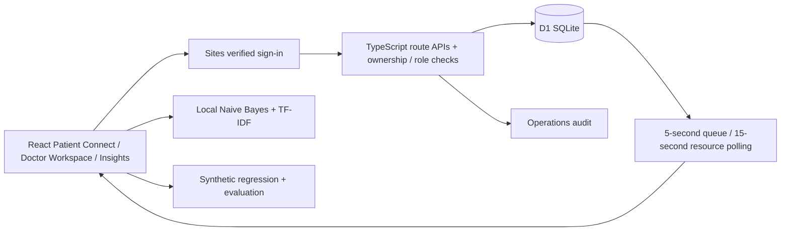

# Korgaonkar Care AI — implementation milestone

Intelligent Healthcare. Personalized Care.

This upgrades the existing HealthSathi project in place. Korgaonkar Multispeciality Hospital, its branches, doctors, queues and resource counts are fictional. Existing booking records and identifiers are preserved. Official Goa healthcare links remain external references, not Korgaonkar services.

## What this pass delivers

| Module | Implemented status |
|---|---|
| Branding | Korgaonkar Care AI, Korgaonkar AI, Patient Connect, Doctor Workspace and Insights |
| Doctor discovery and booking | Existing database-backed search, schedules, unique slot booking, cancellation and atomic rescheduling preserved; booking reference also added to chat |
| OPD queue | Persistent daily per-doctor tokens, five-second polling, serving token, own patient tokens, estimates, staff walk-ins, next/complete/skip/recall and doctor pause |
| Staff access | Verified account email grants for receptionists and doctor-specific staff; administrator configured through server secret; all new APIs authorize server-side |
| Resources | Persistent demo bed/service records, editable capacity and availability, update timestamps, occupancy totals, 15-second refresh |
| AI research | Existing trained Naive Bayes classifier plus computed per-class precision/recall/F1/confusion matrix; deterministic synthetic ridge-regression experiment with baseline MAE/RMSE; downloadable JSON results |
| Patient tools | Existing consent-gated report value comparison, reminders/calendar export, support requests and internal replies retained |
| Audit | New operations mutations record actor, action, target and timestamp; failed/no-op transition attempts can also be recorded |

This is a working vertical slice, **not completion of the entire seven-phase brief**.

## Remaining scope

- LLM generation, sentence embeddings, FAISS/Chroma, document ingestion and administrator knowledge approval are not implemented. Current retrieval is TF-IDF over curated summaries; no LLM key is required or used.
- PDF/image report upload, OCR, extracted-value review and downloadable report explanations remain pending. Existing report helper accepts typed synthetic values only.
- Hindi/Marathi/Konkani remain limited experimental phrase normalization. Generated multilingual replies and verified voice support are not complete.
- Queue prediction in the patient view is a transparent operational average (or 10-minute baseline); the separately trained synthetic regression is a research experiment, not a clinical waiting-time model.
- No billing ledger, payment processing, background notification worker, simulated outbound-delivery log, interactive floor map, persisted/searchable chat history or comprehensive RAG/safety dashboard yet.
- No Python/FastAPI/PostgreSQL migration. The existing React/TypeScript/Cloudflare D1 architecture is retained to keep the hosted application runnable.
- Dataset remains the original 18 fictional doctor profiles in 6 specialties across three fictional branches. The requested 12-doctor/8-department/30-patient seed package is pending.
- Staff queue and appointment visibility are implemented. Receptionist appointment editing, role-scoped support-ticket assignment, organization-wide role administration, retention policies, independent security assessment and clinical validation remain pending.
- No real hospital system, emergency entrance, inventory, insurance coverage or appointment confirmation is connected. Existing emergency guidance remains conservative and should not be treated as validated triage.

## Run locally

Use Node 22.13 or newer. From this directory:

```powershell
npm install
npm run build
```

Set ignored `.dev.vars` to `ADMIN_EMAIL="seedy@sites.test"` for the starter's local simulated sign-in. Never use this local identity as production authentication. Hosted access uses the existing Sites sign-in; production `ADMIN_EMAIL` is a secret matching the authorized demo owner. There are no shared demo passwords. Doctor/reception roles use verified sign-in emails and also require separate access to the private Site; adding an application role does not invite anyone.

Fresh local databases need migrations `0000` through `0004` applied once, in order. For each unapplied file:

```powershell
node --import ./scripts/sites-env.mjs ./node_modules/wrangler/bin/wrangler.js d1 execute DB --local --config dist/server/wrangler.json --persist-to .wrangler/state --file drizzle/0004_vengeful_wild_child.sql
npm run dev
```

Do not replay migrations on an existing database. Sites applies new packaged migrations during deployment. `0004` creates operational tables and rebrands seeded hospital IDs without deleting bookings.

Sign in locally via `/signin-with-chatgpt?return_to=/`. An empty hospital catalogue is seeded by the existing admin initialization API (`POST /api/hospital`, action `initialize`). Existing databases retain their data. Resource records are created explicitly using Hospital resources → choose a demo resource → Save. Queue demo data is created using Generate synthetic walk-in token; no patient names are needed.

## Demonstration sequence

1. In Care assistant ask for a skin specialist, select a fictional hospital and doctor, choose a slot and submit a fictional alias. The booking is saved as awaiting confirmation.
2. In Doctor workspace, refresh upcoming appointments; the administrator/receptionist sees the request. Doctors see only their assigned profile's appointments.
3. In OPD queue, select a doctor, generate two synthetic walk-ins, then Call next patient. Complete, skip, recall and pause/resume the queue. Queue readers poll the same database every five seconds.
4. A patient with an active appointment for **today** can enter their booking reference to check in. Other accounts' bookings are rejected. Ordinary patients see only their tokens plus aggregate queue status. Walk-ins are anonymous synthetic tokens visible to authorized staff.
5. In Hospital resources, add General ward, set capacity and available count, save and inspect occupancy and update time. Resource data belongs to the fictional Korgaonkar demo, not any real facility.
6. In AI / ML lab, inspect the trained classifier, confusion matrix, regression results and export JSON. Describe the small/synthetic evaluation limitations during presentation.

## API additions

All `/api/operations` requests require sign-in. GET responses use `Cache-Control: no-store`. POST requires matching Origin and validated bounded input.

| Method/action | Authorization | Purpose |
|---|---|---|
| GET identity | Signed in | Role and assigned doctor |
| GET queue&doctor=ID | Signed in | Own tokens + aggregates; scoped staff get queue controls |
| GET resources | Signed in | Fictional resource counts and timestamps |
| GET appointments | Reception/admin or assigned doctor | Upcoming appointment records, capped at 100 |
| GET staff / audit | Admin | Grants / latest 50 audit events |
| POST checkin | Booking owner | Requires active booking today for selected doctor |
| POST walkin | Scoped staff | Create anonymous synthetic token |
| POST next / complete / skip / recall / presence | Scoped staff | Validated queue transitions |
| POST resource | Reception/admin | Upsert resource, 0 ≤ available ≤ capacity ≤ 1000 |
| POST role | Admin | Assign receptionist/doctor, or patient to revoke staff role |

Example operation body: `{"action":"next","doctorId":"gmc-d0"}`. Token mutations accept `id`; check-in accepts `bookingId`; presence accepts boolean `available`. Resource bodies contain `id,name,kind,capacity,available,status`; kinds are `bed`/`service`. Role bodies contain `email,role,doctorId` (doctor ID required for doctor role). Validation returns 400, unauthenticated 401, unauthorized 403, invalid/conflicting transitions 409. Unique indexes guarantee per-doctor daily token numbers, one queue check-in per booking, and at most one serving token. Token allocation uses a single INSERT SELECT; mutations/audit writes use transactional D1 batches.

## Architecture



Schema source: `db/schema.ts`. Existing entities: hospitals, departments, doctors, schedules, appointment_slots, bookings, legacy appointments, holidays, feedback, usage_totals, department_usage, followup_reminders, staff_requests, facility_directory. New entities: `queue_tokens` (doctor/date/token/owner/booking/status/timestamps), `doctor_presence`, `hospital_resources`, `staff_roles` and `operations_audit`. Patient ownership remains the verified Sites user ID rather than a separate password database. A cancelled booking does not automatically cancel a previously created queue token; staff must manage that token explicitly.

## Verification commands

With the local server running:

```powershell
node scripts/test-ml.mjs
node scripts/test-hospital.mjs
node scripts/test-api.mjs
node scripts/test-support.mjs
node scripts/test-operations.mjs
node scripts/test-research.mjs
node node_modules/typescript/bin/tsc --noEmit
npm run build
```

Operations integration tests cover anonymous access, bad Origin, invalid capacity, prohibited admin role grant, invalid doctor assignment, nonowned check-in, concurrent numbering/call-next, completion, skip/recall, pause/resume and audit. They use only `127.0.0.1:5173` and leave completed synthetic queue tokens in the local database. Multi-account hosted authorization, clinical safety performance, accessibility conformance and load testing require additional validation; these are not claimed by a passing single-account integration suite.

No paid API or messaging service was enabled. Existing hosting/database limits still apply; this is not a guarantee of unlimited free service.
